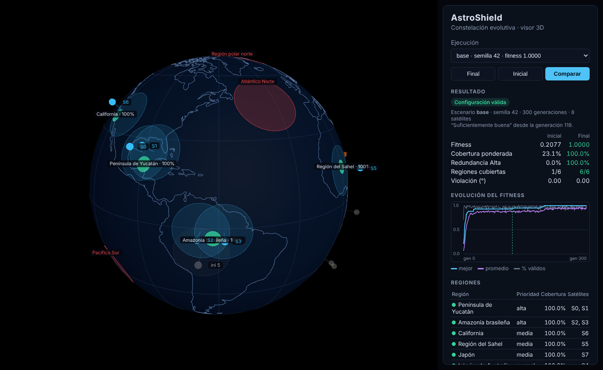

# AstroShield — Evolucionar una constelación inteligente

Proyecto de **Fundamentos de Inteligencia Artificial** (grupo LITIID71). Un **algoritmo genético** diseña una constelación de **8 satélites** para observar 6 regiones de la Tierra con distinta prioridad. Debe respetar:
- 3 zonas de desechos espaciales;
- 2 posiciones ocupadas por otros objetos;
- una separación mínima entre satélites.

El resultado se explora en un **globo 3D** que lee los datos reales de cada ejecución.



## Equipo

| Integrante | Responsabilidad | Archivos principales |
|---|---|---|
| Hector Partido Flores | Coordinación, integración, geometría y escenarios | `geo.py`, `escenario.py`, `config/`, docs 01 y README |
| Hector Martínez Sánchez | Función de evaluación y restricciones | `fitness.py`, `restricciones.py` |
| Gildardo Emmanuel González García | Algoritmo evolutivo y línea de comandos | `ga.py`, `cli.py` |
| Ismael Alexander Hidalgo Aguilando | Visualización 3D | `viz/`, doc 05 |
| Anthony Oziel Ramos López | Pruebas, experimentos y análisis | `tests/`, `experiments/`, docs 03 y 04 |

## Resultados principales

| Escenario | Fitness final (10 semillas) | Regiones cubiertas | Soluciones válidas |
|---|---|---|---|
| Base (el de la actividad) | 0.995 ± 0.015 | 6/6 en 10 de 10 | 10/10 |
| Espacio reducido | 1.000 ± 0.000 | 6/6 en 10 de 10 | 10/10 |
| Inviable (Yucatán bloqueado) | 0.7423 = máximo teórico | 5/6, Yucatán reportada como imposible | 10/10 |

Ninguna de las **90 soluciones finales** revisadas invade una zona restringida. Detalle en [docs/03_pruebas.md](docs/03_pruebas.md).

## Instalación

Requiere **Python 3.10+** y **Git**. El visor necesita internet la primera vez para descargar Three.js.

```bash
git clone https://github.com/HectorPartido/litiid71-AstroShield.git
cd litiid71-AstroShield
```

**Windows (PowerShell):**
```powershell
py -m venv .venv
.venv\Scripts\Activate.ps1
pip install -e ".[dev]"
```

**macOS / Linux:**
```bash
python3 -m venv .venv
source .venv/bin/activate
pip install -e ".[dev]"
```

## Uso

### 1. Ejecutar el algoritmo evolutivo

```bash
python -m astroshield.cli run --escenario config/escenarios/base.json
```

Imprime la evolución cada 20 generaciones y una tabla comparando la configuración **inicial** contra la **final**: fitness, cobertura por región, validez y violaciones. Guarda:
- `results/base_s42.json`: resultado completo;
- `results/base_s42.csv`: historial por generación.

Opciones:

| Opción | Ejemplo | Efecto |
|---|---|---|
| `--escenario` | `config/escenarios/inviable.json` | Otro escenario |
| `--semilla` | `--semilla 7` | Otra ejecución reproducible |
| `--generaciones` | `--generaciones 500` | Máximo de generaciones |
| `--poblacion` | `--poblacion 100` | Tamaño de población |
| `--prob-mutacion`, `--sigma` | `--sigma 3` | Mutación gaussiana |
| `--satelites` | `--satelites 6` | Cambiar el número de satélites |
| `--nombre` | `--nombre prueba1` | Nombre del archivo de salida |

### 2. Cambio de condiciones (¿sigue siendo válida una solución vieja?)

```bash
python -m astroshield.cli reevaluar --resultado results/base_s42.json --escenario config/escenarios/inviable.json
```

### 3. Visualización 3D

```bash
python -m http.server 8000
```
Abre <http://localhost:8000/viz/>. Desde ahí puedes:
- elegir cualquier ejecución;
- alternar entre **Final / Inicial / Comparar**;
- girar el globo con el mouse.

### 4. Pruebas automáticas y experimentos

```bash
pytest                                   # 55 pruebas
python experiments/correr_pruebas.py     # pruebas P1-P12, tablas y gráficas (4-15 min)
python experiments/demo_evaluacion.py    # cómo responde el fitness a casos conocidos
```

## Escenarios

| Archivo | Descripción |
|---|---|
| `base.json` | Datos oficiales de la actividad |
| `sin_restricciones.json` | Sin zonas ni objetos (primera etapa) |
| `reducido.json` | +3 zonas de desechos junto a las regiones |
| `inviable.json` | Zona de 15° sobre el Golfo de México: Yucatán imposible |
| `prioridades_cambiadas.json` | Australia → Alta, Yucatán → Normal, zona nueva sobre Japón |

Los escenarios derivados **heredan** de `base.json` y solo declaran lo que cambia.

## Estructura del repositorio

```
config/escenarios/   Escenarios en JSON
src/astroshield/
  geo.py             Geometría esférica (haversine, punto destino, muestreo)
  escenario.py       Carga y validación de escenarios
  restricciones.py   Zonas prohibidas, separación y regla de factibilidad
  fitness.py         Cobertura ponderada + redundancia
  ga.py              Algoritmo genético
  cli.py             Comandos run y reevaluar
tests/               55 pruebas automáticas (pytest)
experiments/         Batería de experimentos y demostración del fitness
results/             Resultados reales (JSON, CSV, experimentos, reevaluaciones)
viz/                 Visor 3D (Three.js)
docs/                Entregables escritos y figuras
```

## Entregables

| # | Entregable | Dónde está |
|---|---|---|
| 1 | Definición del problema | [docs/01_definicion_problema.md](docs/01_definicion_problema.md) |
| 2 | Implementación funcional | `src/astroshield/` + sección **Uso** de este README |
| 3 | Pruebas y validación | [docs/03_pruebas.md](docs/03_pruebas.md), `tests/`, `results/experimentos/` |
| 4 | Análisis de resultados | [docs/04_analisis.md](docs/04_analisis.md) |
| 5 | Visualización 3D | `viz/`, [docs/05_visualizacion.md](docs/05_visualizacion.md) |
| 6 | Repositorio y presentación | Este README, [docs/guion_presentacion.md](docs/guion_presentacion.md), historial de commits |
| — | Uso de inteligencia artificial | [docs/uso_ia.md](docs/uso_ia.md) |
| — | Contrato entre módulos | [docs/contrato.md](docs/contrato.md) |

## Modelo en una línea

Cada satélite es un punto fijo (lat, lon) que ve un círculo de 10°. Una región de 300 km está cubierta si ≥ 90 % de sus 37 puntos de muestra son vistos. La función de evaluación es:

```
fitness = 0.9 · cobertura_ponderada (pesos 3/2/1) + 0.1 · redundancia de las regiones Alta
```

Una configuración que invade una zona **siempre pierde** contra una válida (regla de factibilidad de Deb). Supuestos y justificación completa en el [Entregable 1](docs/01_definicion_problema.md).