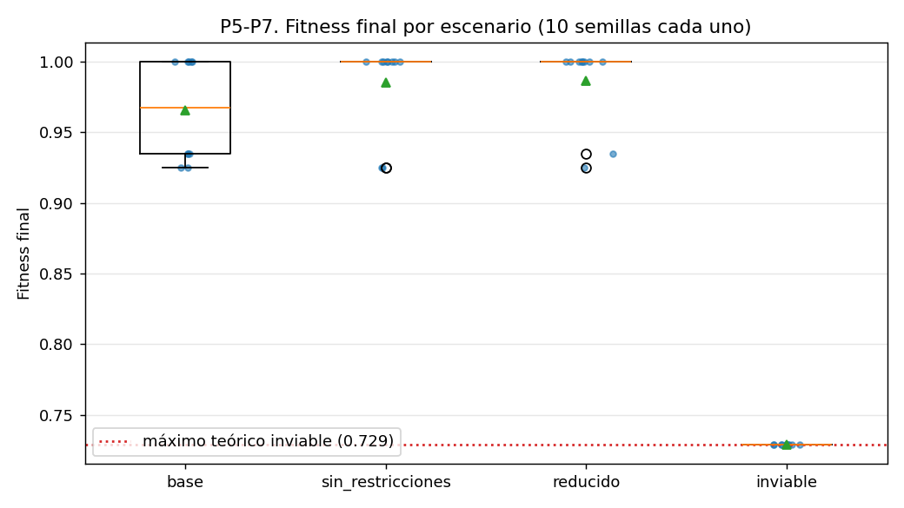
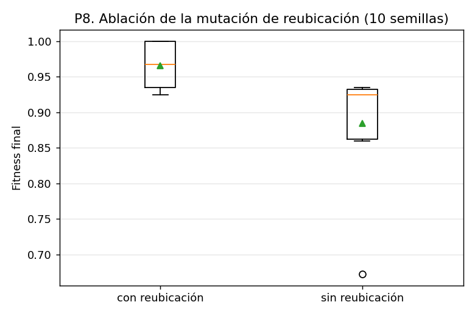

# Entregable 3 — Pruebas y validación

**Proyecto:** AstroShield  
**Responsable:** Anthony Oziel Ramos López

Todas las cifras de este documento salen de `results/experimentos/resumen.md`, generado por el propio programa con `python experiments/correr_pruebas.py`. Ningún número se editó a mano.

---

## 1. Cómo se probó y cómo se reproduce

La validación tiene dos niveles:

1. **Pruebas automáticas** (`pytest`): comprueban que cada componente hace lo que dice y que el algoritmo completo respeta las restricciones.
2. **Batería experimental** (`experiments/correr_pruebas.py`): ejecuta el algoritmo muchas veces, en distintos escenarios y con distintas semillas, y deja la evidencia en tablas, CSV y gráficas.

```bash
pip install -e .
pytest
python experiments/correr_pruebas.py      # tarda entre 4 y 15 minutos
```

**Semillas.** La ejecución oficial usa la semilla **42**. Para comparar escenarios se usan las semillas **1 a 10**, y para el barrido de satélites las semillas **1 a 5**. Se usan varias semillas porque una sola ejecución puede tener suerte; con diez se reporta media ± desviación y se ve cuánto varía el resultado.

---

## 2. Pruebas automáticas

`pytest` ejecuta **55 pruebas** y las 55 pasan (≈ 61 s).

| Archivo | Pruebas | Qué verifica |
|---|---|---|
| `tests/test_geo.py` | 13 | Distancia angular (cero, polo a polo, antimeridiano, simetría), conversión km ↔ grados, normalización de coordenadas, punto destino, muestreo de una región y latitudes uniformes en área |
| `tests/test_escenario.py` | 7 | Datos del escenario base, herencia que agrega, quita y cambia elementos, carga de todos los escenarios y errores ante datos inválidos |
| `tests/test_fitness.py` | 8 | Cobertura, redundancia solo en regiones de prioridad Alta, independencia del orden de los satélites y la prueba que fija que cubrir una región nueva vale más que un respaldo |
| `tests/test_ga.py` | 10 | Operadores y ejecución del algoritmo evolutivo |
| `tests/test_restricciones.py` | 10 | Detección de satélites dentro de zonas restringidas y posiciones ocupadas |
| `tests/test_escenarios_completos.py` | 7 | Punta a punta: ninguna solución final invade zonas (4 escenarios), la población inicial sí tiene configuraciones inválidas y el algoritmo las elimina, el escenario inviable reporta Yucatán sin cubrir y con 4 satélites no se pueden cubrir 6 regiones |

---

## 3. Batería experimental: las 12 pruebas

| Prueba | Qué responde | Condiciones | Evidencia |
|---|---|---|---|
| P1 | Escenario inicial | `base`, semilla 42 | `results/base_s42.json` y `.csv` |
| P2 | Evolución del algoritmo | historial de P1 | `docs/figuras/p2_evolucion_base.png` |
| P3 | Zonas restringidas | margen a cada zona en las 90 soluciones finales con restricciones | columnas `margen_*` de los CSV |
| P4 | Posiciones ocupadas (objetos A y B) | ídem | ídem |
| P5 | Espacio reducido | `reducido`, 10 semillas | `semillas.csv`, `p5_p7_escenarios.png` |
| P6 | Condición inviable | `inviable`, 10 semillas | `semillas.csv`, `p5_p7_escenarios.png` |
| P7 | Variación entre ejecuciones | `base`, 10 semillas | `semillas.csv`, `p7_variacion_semillas.png` |
| P8 | ¿Sirve la mutación de reubicación? (propia A) | `base`, sin reubicación, 10 semillas | `ablacion_reubicacion.csv`, `p8_ablacion_reubicacion.png` |
| P9 | ¿Cuántos satélites hacen falta? (propia B) | `base` con 4 a 8 satélites, 5 semillas c/u | `barrido_satelites.csv`, `p9_num_satelites.png` |
| P10 | Cambio de condiciones (3.3) | solución de `base_s42` evaluada en otros escenarios | `results/reevaluaciones/*.json` |
| P11 | Peso de redundancia (propia C) | 0.15 contra 0.10, 10 semillas | `calibracion_peso_redundancia.csv` |
| P12 | Criterio de paro (propia D) | paciencia 80 contra 150, 11 semillas | `criterio_paro.csv` |

Los CSV están en `results/experimentos/`.

---

## 4. Resultados por prueba

### P1. Escenario inicial (base, semilla 42)

- Fitness: **0.2077 → 1.0000**.
- Regiones cubiertas: **6/6**; solución **válida**.
- Primera generación suficientemente buena: **119**. Generaciones ejecutadas: 300 (el límite).

| Región | Prioridad | Cobertura | Redundancia | Cubierta | Satélites |
|---|---|---|---|---|---|
| Península de Yucatán, México | alta | 100% | 100% | sí | S0, S1 |
| Amazonía brasileña | alta | 100% | 100% | sí | S2, S3 |
| California, Estados Unidos | media | 100% | 0% | sí | S6 |
| Región del Sahel, África | media | 100% | 0% | sí | S5 |
| Japón | media | 100% | 0% | sí | S7 |
| Interior de Australia | normal | 100% | 0% | sí | S4 |

| Satélite | Latitud | Longitud |
|---|---|---|
| S0 | 24.6592 | -90.7567 |
| S1 | 25.3297 | -85.8736 |
| S2 | -1.1545 | -66.2705 |
| S3 | -1.4471 | -58.2631 |
| S4 | -27.9946 | 126.6602 |
| S5 | 13.4973 | 0.5629 |
| S6 | 38.6294 | -111.4923 |
| S7 | 39.1132 | 131.4582 |

Con 8 satélites y 6 regiones, los dos satélites "sobrantes" quedan como respaldo de las dos regiones de prioridad Alta (Yucatán y Amazonía), que son las únicas con redundancia del 100%.

### P2. Evolución (base, semilla 42)


Momentos relevantes (la tabla completa está en `resumen.md`):

| Gen | Mejor | Promedio | Peor | % válidos | Regiones (mejor) | Diversidad (°) |
|---|---|---|---|---|---|---|
| 0 | 0.2077 | 0.0628 | 0.0000 | 70% | 1 | 71.3 |
| 2 | 0.3462 | 0.1475 | 0.0000 | 100% | 2 | 67.5 |
| 9 | 0.8578 | 0.6326 | 0.3462 | 100% | 5 | 39.4 |
| 27 | 0.9308 | 0.8393 | 0.5571 | 100% | 5 | 21.9 |
| 119 | 0.9388 | 0.8774 | 0.6596 | 95% | 6 | 19.2 |
| 197 | 1.0000 | 0.9120 | 0.7163 | 100% | 6 | 12.2 |
| 300 | 1.0000 | 0.9442 | 0.7923 | 98% | 6 | 15.3 |

Lo que muestra:

- **La población inicial sí tiene configuraciones inválidas:** solo el 70% es válido en la generación 0; desde la generación 2 se mantiene entre 95% y 100%.
- **Mejora rápida al inicio:** de 1 a 5 regiones cubiertas en 9 generaciones.
- **Meseta:** entre las generaciones 27 y 119 el mejor fitness se queda en 0.9308 (5/6 regiones). La generación 119 es la primera con las 6 regiones cubiertas (0.9388).
- **El 1.0000 llega tarde:** hasta la generación 197, cuando el algoritmo coloca el respaldo de las dos regiones Alta.
- **Diversidad:** baja de 71.3° a 12.2° al converger. Con la población tan concentrada, los cambios grandes de posición (como la mutación de reubicación, ver P8) son una de las pocas vías para salir de una meseta.

### P3 y P4. Zonas restringidas y posiciones ocupadas

Se revisaron **90 soluciones finales** de todos los experimentos que tienen restricciones: 4 oficiales (`base`, `reducido`, `inviable`, `prioridades_cambiadas`), 30 de las diez semillas por escenario, 10 de la ablación, 25 del barrido de satélites, 10 de la calibración y 11 del criterio de paro. *Margen* = distancia del satélite más cercano al borde de la zona (positivo = afuera).

| Zona | Tipo | Radio | Margen mínimo observado | Soluciones que la invaden |
|---|---|---|---|---|
| Atlántico Norte | desechos | 12° | 5.31° | 0 |
| Pacífico Sur | desechos | 10° | 18.98° | 0 |
| Región polar norte | desechos | 8° | 3.42° | 0 |
| Objeto A | ocupado | 5° | 4.54° | 0 |
| Objeto B | ocupado | 5° | 1.34° | 0 |

**Soluciones finales inválidas: 0 de 90.**

Los márgenes mínimos son positivos pero algunos son pequeños (Objeto B: 1.34°, región polar norte: 3.42°): el algoritmo se acerca al borde de la zona sin cruzarlo. La tabla solo lista las zonas del escenario base; las zonas adicionales de `reducido` e `inviable` se verifican con el indicador de validez de cada solución (todas válidas).

**Contraprueba.** Se evaluaron con las restricciones del escenario base las 10 soluciones obtenidas *sin* restricciones. Resultado: **0 de 10 resultan inválidas**. Es decir, en el escenario base las zonas prohibidas no estorban a las posiciones que el algoritmo elige aun sin conocerlas, así que esta contraprueba **no demuestra por sí sola** que las restricciones cambien el resultado. La evidencia de que sí influyen está en P5, P6 y P10.

### P5, P6 y P7. Diez semillas por escenario



| Escenario | Fitness final (media ± desv.) | Regiones prom. | Corridas con 6/6 | Válidas | Suficientemente buena | Generaciones prom. |
|---|---|---|---|---|---|---|
| base | 0.9950 ± 0.0150 (mín 0.9500, máx 1.0000) | 6.0 | 10 | 10 | 10/10 (gen. media 22) | 224 |
| sin_restricciones | 1.0000 ± 0.0000 | 6.0 | 10 | 10 | 10/10 (gen. media 28) | 230 |
| reducido | 1.0000 ± 0.0000 | 6.0 | 10 | 10 | 10/10 (gen. media 50) | 261 |
| inviable | 0.7423 ± 0.0000 | 5.0 | 0 | 10 | 0/10 | 166 |

**P5, espacio reducido.** Con tres zonas restringidas más (8 en total) las 10 semillas siguen cubriendo las 6 regiones con fitness 1.0000. Lo que cambia es el esfuerzo: la generación media en que la solución es suficientemente buena sube de 22 (base) a 50.

**P6, condición inviable.** Yucatán queda dentro de una zona prohibida y no puede cubrirse. El sistema:

- entrega una solución **válida** con 5/6 regiones (en lugar de una completa pero inválida);
- reporta Yucatán con 0% de cobertura;
- **no** la declara suficientemente buena (0/10).

El máximo teórico es 0.90·10/13 + 0.10·0.5 = **0.7423**: si Yucatán (peso 3 de 13) no se puede ver, la cobertura ponderada máxima es 10/13, y Amazonía sí puede tener respaldo. **Las 10 de 10 corridas alcanzaron exactamente ese máximo.**

**P7, variación entre ejecuciones (base).**


| Semilla | Fitness | Regiones | Gen. suficiente | Generaciones |
|---|---|---|---|---|
| 1 | 1.0000 | 6 | 86 | 242 |
| 2 | 1.0000 | 6 | 19 | 186 |
| 3 | 1.0000 | 6 | 13 | 218 |
| 4 | 1.0000 | 6 | 10 | 259 |
| 5 | 1.0000 | 6 | 16 | 193 |
| 6 | 1.0000 | 6 | 17 | 222 |
| 7 | 1.0000 | 6 | 15 | 292 |
| 8 | 1.0000 | 6 | 15 | 175 |
| 9 | 1.0000 | 6 | 19 | 283 |
| 10 | 0.9500 | 6 | 13 | 169 |

El resultado final es estable (9 de 10 semillas llegan a 1.0000 y la restante a 0.9500 con las 6 regiones cubiertas), pero el **tiempo para llegar** varía mucho: de la generación 10 a la 86. La semilla 10 cubre las 6 regiones pero solo respalda una de las dos regiones Alta.

Cobertura promedio por región (10 semillas):

| Escenario | Yucatán | Amazonía | California | Sahel | Japón | Australia |
|---|---|---|---|---|---|---|
| base | 100% | 100% | 100% | 100% | 100% | 100% |
| sin_restricciones | 100% | 100% | 100% | 100% | 100% | 100% |
| reducido | 100% | 100% | 100% | 100% | 100% | 100% |
| inviable | 0% | 100% | 100% | 100% | 100% | 100% |

### P8. Prueba propia A — ¿sirve la mutación de reubicación?



| Variante | Fitness final | Regiones prom. | Corridas con 6/6 | Suficientemente buena |
|---|---|---|---|---|
| Con reubicación (0.03) | 0.9950 ± 0.0150 (mín 0.9500, máx 1.0000) | 6.0 | 10 | 10 |
| Sin reubicación (0.0) | 0.8800 ± 0.0911 (mín 0.6538, máx 1.0000) | 5.1 | 3 | 3 |

Sin la mutación de reubicación, solo 3 de 10 corridas cubren las 6 regiones y el peor caso baja a 0.6538. La mutación de reubicación mueve un satélite a una posición nueva en lugar de ajustar la que ya tiene; los datos indican que sin ese tipo de salto el algoritmo se estanca con más frecuencia en soluciones de 5 regiones.

### P9. Prueba propia B — ¿cuántos satélites hacen falta?


| Satélites | Fitness final | Regiones prom. | Redundancia Alta prom. | Suficientemente buena (de 5) |
|---|---|---|---|---|
| 4 | 0.6923 | 4.0 | 0.00 | 0 |
| 5 | 0.8308 | 5.0 | 0.00 | 0 |
| 6 | 0.9000 | 6.0 | 0.00 | 5 |
| 7 | 0.9500 | 6.0 | 0.50 | 5 |
| 8 | 1.0000 | 6.0 | 1.00 | 5 |

Las cinco semillas dan exactamente el mismo resultado en cada tamaño (desviación 0). **Seis satélites son el mínimo para cubrir las 6 regiones; el séptimo respalda una región Alta y el octavo respalda las dos.** Con 8 satélites se alcanza el 1.0000 y no queda ningún satélite sin función.

### P10. Cambio de condiciones (3.3)

¿Qué pasa con la solución de `base_s42` cuando cambian las condiciones?

| Escenario nuevo | Fitness de la sol. vieja | Regiones | ¿Válida? | Violaciones | Fitness al re-ejecutar (s42) |
|---|---|---|---|---|---|
| prioridades_cambiadas | 0.9500 | 6 | sí | — | 1.0000 (6/6) |
| reducido | n/a (inválida) | 6 | **NO** | S7 → mar_de_japon | 1.0000 (6/6) |
| inviable | n/a (inválida) | 6 | **NO** | S0 y S1 → golfo_mexico | 0.7423 (5/6) |

> Para las soluciones inválidas el evaluador calcula un valor numérico, pero no tiene significado porque la solución no es utilizable; por eso se marca como n/a.

- **Prioridades cambiadas:** la solución vieja sigue siendo válida pero ya no es la mejor (0.9500 contra 1.0000 al volver a ejecutar).
- **Espacio reducido:** la solución vieja es inválida porque S7 queda dentro del Mar de Japón. Hay que recalcular, y el algoritmo encuentra otra solución con 6/6.
- **Condición inviable:** la solución vieja es inválida porque S0 y S1 quedan en el Golfo de México. Al recalcular, el sistema entrega la mejor solución válida posible (5/6, el máximo teórico).

Conclusión: una solución calculada para unas condiciones **no debe reutilizarse** sin reevaluarla, y la evaluación detecta de forma automática cuándo deja de ser válida.

### P11. Prueba propia C — calibración del peso de redundancia

Mismo escenario base y mismas 10 semillas; solo cambia `peso_redundancia`.

| peso_redundancia | Corridas con 6/6 | Corridas que abandonan Australia | Cobertura prom. Australia | Suficientemente buena |
|---|---|---|---|---|
| 0.15 (original) | 9 | 1 | 90% | 9 |
| 0.10 (actual) | 10 | 0 | 100% | 10 |

Con 0.15, el respaldo de media región Alta valía 0.15 · 0.5 = 0.075, más que cubrir Australia (0.85 · 1/13 ≈ 0.065), y en 1 de 10 corridas el algoritmo prefirió dejar Australia sin cubrir. Con 0.10, cubrir una región nueva (≥ 0.9 · 1/13 ≈ 0.069) siempre vale más que medio respaldo (0.05). El fitness no se compara entre pesos distintos, porque cambia la escala; por eso la tabla usa métricas de cobertura.

### P12. Prueba propia D — criterio de paro (paciencia)

Mismas semillas; cambia cuántas generaciones sin mejora se toleran antes de detenerse. La variante original usaba paciencia 80 con tope de 200 generaciones; la actual, paciencia 150 con tope de 300.

| Semilla | Paciencia 80: fitness (gen. al parar) | Paciencia 150: fitness (gen. al parar) | ¿Mejoró al esperar más? |
|---|---|---|---|
| 1 | 1.0000 (172) | 1.0000 (242) | no |
| 2 | 1.0000 (116) | 1.0000 (186) | no |
| 3 | 1.0000 (148) | 1.0000 (218) | no |
| 4 | 1.0000 (189) | 1.0000 (259) | no |
| 5 | 1.0000 (123) | 1.0000 (193) | no |
| 6 | 1.0000 (152) | 1.0000 (222) | no |
| 7 | 0.9500 (98) | 1.0000 (292) | **sí** |
| 8 | 1.0000 (105) | 1.0000 (175) | no |
| 9 | 1.0000 (200) | 1.0000 (283) | no |
| 10 | 0.9500 (99) | 0.9500 (169) | no |
| 42 | 0.9308 (107) | 1.0000 (300) | **sí** |

Esperar más mejora 2 de 11 semillas (7 y 42) y no empeora ninguna. El caso más claro es la semilla 42: con paciencia 80 se detenía en la generación 107 con 0.9308 (5/6 regiones); con 150 sigue, cubre las 6 regiones en la generación 119 y llega a 1.0000 en la 197.

---

## 5. Hallazgos de las pruebas: defectos detectados y su efecto

La batería detectó dos defectos reales en lo que ya estaba entregado. Ambos se corrigieron antes de generar los resultados finales.

| Defecto | Evidencia | Efecto si no se corrige | Corrección |
|---|---|---|---|
| Peso de redundancia 0.15: respaldar media región Alta (0.075) valía más que cubrir Australia (0.065) | P11: con 0.15, 1 de 10 corridas abandona Australia; la prueba `test_cubrir_una_region_nueva_vale_mas_que_un_respaldo` falla con 0.15 | El algoritmo puede dejar una región sin cubrir para reforzar otra | `peso_redundancia = 0.10`, configurable en el escenario |
| Paciencia 80 y 200 generaciones: la semilla 42 se detenía en una meseta con 5/6 regiones | P12: 0.9308 contra 1.0000 con paciencia 150 | El algoritmo entrega una solución incompleta creyendo que ya no puede mejorar | Paciencia 150 y 300 generaciones |

**Nota sobre la cifra de P11.** El Entregable 1 menciona 3 de 10 ejecuciones con Australia abandonada: esa fue la primera detección del defecto, cuando el algoritmo todavía usaba paciencia 80. Esta batería, con la configuración final del algoritmo, mide **1 de 10** con peso 0.15. La cifra oficial de este documento es la de la batería. La diferencia entre 9 y 10 corridas es pequeña; el argumento más sólido para el cambio es la comparación de valores de arriba (0.075 contra 0.065), y P11 es la evidencia que lo respalda.

---

## 6. Correspondencia entre los datos y la visualización

El visor 3D (`viz/`) no tiene datos escritos en el código: lee `results/index.json` y `results/<escenario>_s42.json`, los mismos archivos de donde salen las tablas de este documento. Verificación hecha sobre la ejecución oficial:

| Dato en los resultados | Lo que muestra el visor |
|---|---|
| `final.satelites`: S0 (24.66°, −90.76°) y S1 (25.33°, −85.87°) | Dos satélites sobre el Golfo de México, encima de Yucatán |
| `regiones[yucatan].satelites_que_ven = [0, 1]` | Yucatán en verde; la tabla del panel dice "S0, S1" |
| `inicial.evaluacion.fitness = 0.2077`, `final.evaluacion.fitness = 1.0` | Panel "Resultado": 0.2077 → 1.0000 |
| `gen_suficiente = 119` | Línea punteada verde en la gráfica del panel y el texto "Suficientemente buena desde la generación 119" |
| `inviable_s42.json`: `yucatan.cobertura = 0` | Yucatán en rojo con "0%" y la zona "Golfo de México (nueva)" dibujada |
| `historial` | La gráfica del panel muestra la meseta de la generación 27 a la 119, igual que `p2_evolucion_base.png` |

Además, los círculos del globo se trazan con la misma fórmula de punto destino que usa `src/astroshield/geo.py`, así que una región que el modelo da por cubierta queda dentro del círculo de alcance de su satélite.

---

## 7. Limitaciones de la validación

- **Diez semillas** dan una buena idea de la variabilidad, pero no es un análisis estadístico formal; las diferencias pequeñas (por ejemplo 22 contra 28 generaciones medias entre `base` y `sin_restricciones`) no son concluyentes.
- **La contraprueba de P3/P4 dio 0 inválidas.** La demostración de que las restricciones condicionan el resultado depende de P5, P6 y P10, no de esa contraprueba.
- **Un solo escenario base.** Las conclusiones de P8 a P12 corresponden a ese escenario; en otro con más regiones o zonas podrían cambiar.
- **Que una ejecución deje de mejorar no prueba que sea el óptimo** (P12). Solo en el escenario inviable se conoce el máximo teórico y se verifica que se alcanzó.