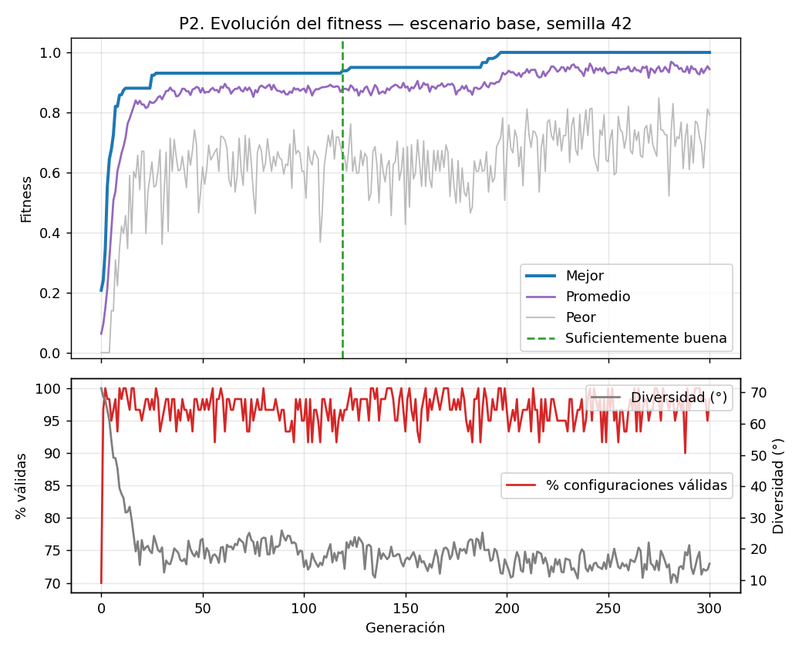
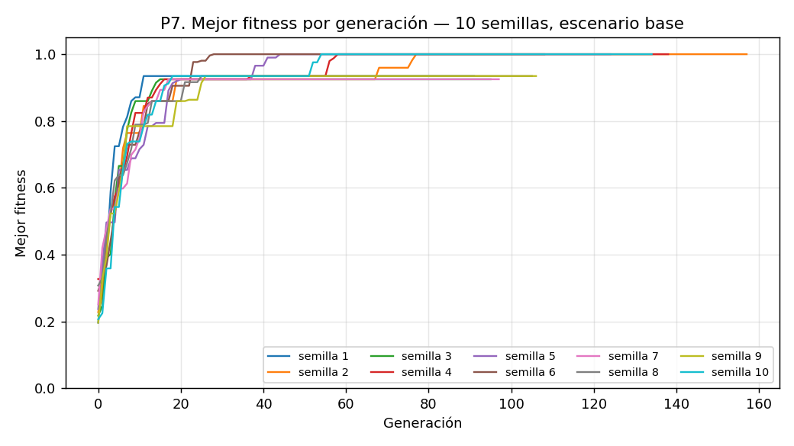
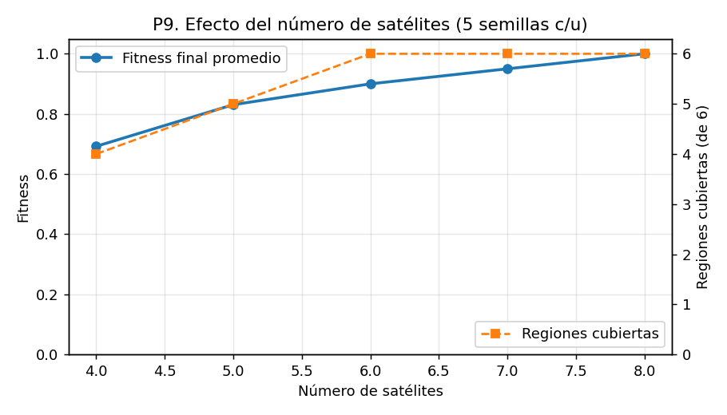

# Entregable 4 — Análisis de resultados

**Proyecto:** AstroShield  
**Responsable:** Anthony Oziel Ramos López

Este documento interpreta la evidencia del Entregable 3. Las cifras provienen de `results/experimentos/resumen.md`; las tablas completas están en `docs/03_pruebas.md`.

**Dónde se responde cada pregunta de la actividad:**

| Pregunta | Sección |
|---|---|
| ¿Qué tan bien se observan las regiones solicitadas en la configuración final? | 1 (hallazgo 1) y 6 |
| ¿Cómo cambió la calidad de la solución durante el proceso evolutivo? | 3 |
| ¿Qué diferencias se encontraron entre distintas ejecuciones? | 6 |
| ¿Qué efecto tuvieron las restricciones espaciales sobre la solución? | 4 |
| ¿Qué sucede cuando el sistema no puede satisfacer todas las condiciones? | 5 y 9 |
| ¿Qué limitaciones tiene el criterio utilizado para evaluar las configuraciones? | 11 |
| ¿Qué evidencia permite afirmar que una solución es mejor que otra? | 2 |

---

## 1. Resumen de hallazgos

| # | Hallazgo | Evidencia |
|---|---|---|
| 1 | El algoritmo cubre las 6 regiones en el escenario base en las 10 semillas y respeta todas las restricciones | P7: 10/10 con 6/6; P3/P4: 0 de 90 soluciones inválidas |
| 2 | Cuando una condición es imposible, entrega la mejor solución válida y lo reporta | P6: 0.7423 en 10/10 corridas, igual al máximo teórico; Yucatán sin cubrir |
| 3 | El resultado final es estable, pero el tiempo para llegar varía mucho | P7: generación suficiente entre 10 y 86 |
| 4 | La mutación de reubicación es necesaria | P8: 10/10 con ella, 3/10 sin ella |
| 5 | Seis satélites son el mínimo; ocho aprovechan todos los recursos | P9 |
| 6 | Una solución vieja puede volverse inválida al cambiar las condiciones | P10: 2 de 3 cambios la invalidan |
| 7 | La prueba encontró dos defectos de configuración que se corrigieron | P11 y P12 |

---

## 2. ¿Qué evidencia permite afirmar que una solución es mejor?

Una solución se considera mejor que otra solo si cumple, en este orden:

1. **Es válida.** Ningún satélite invade una zona de desechos ni una posición ocupada. Una solución inválida no se compara por su fitness: queda descartada (por eso en P10 el fitness de las soluciones inválidas se marca n/a).
2. **Cubre más regiones, con más peso.** La cobertura ponderada es el 90% del fitness. En el escenario base el mínimo para tener las 6 regiones es 6 satélites (P9: fitness 0.9000).
3. **Tiene más respaldo en las regiones de prioridad Alta.** Es el 10% restante. Con 7 satélites el respaldo es 0.50 (fitness 0.9500) y con 8 es 1.00 (fitness 1.0000).

Esto produce una consecuencia importante: **cubrir una región nueva siempre vale más que reforzar una ya cubierta**. Con el peso original (0.15) eso no se cumplía, y por eso se corrigió (sección 7).

Además, el fitness por sí solo no basta. Para saber qué tan buena es una solución hace falta compararla con una referencia:

- **El máximo teórico**, que solo se conoce en el escenario inviable (0.7423) y que las 10 corridas alcanzaron. En el escenario base el máximo es 1.0000 (todo cubierto y respaldado).
- **Varias semillas**, porque una sola ejecución puede tener suerte. Con 10 semillas se ve que el resultado final es casi siempre el mismo.

**Que el algoritmo deje de mejorar no demuestra que haya llegado al óptimo.** P12 lo muestra: con paciencia 80 la semilla 42 se detuvo en 0.9308 (5/6 regiones) tras 80 generaciones sin cambios; al esperar más, llegó a 1.0000.

---

## 3. Comportamiento del algoritmo

En la ejecución oficial (base, semilla 42):

- **Arranque:** el mejor fitness inicial es 0.2077 y solo el 70% de la población es válida. El algoritmo elimina las configuraciones inválidas rápido: desde la generación 2 la población se mantiene entre 95% y 100% válida.
- **Fase de mejora rápida:** pasa de 1 a 5 regiones cubiertas en 9 generaciones (0.8578).
- **Meseta:** del 0.9308 de la generación 27 no mejora hasta la generación 119, que es la primera con las 6 regiones cubiertas (0.9388).
- **Cierre:** el 1.0000 llega en la generación 197, cuando se completa el respaldo de las dos regiones Alta.
- **Diversidad:** baja de 71.3° a 12.2° entre la generación 0 y la 197. Con una población tan concentrada, mejorar depende de cambios grandes de posición.

El patrón en dos etapas (primero cobertura, luego respaldo) es consecuencia de cómo se construye el fitness: la cobertura pesa más, así que se resuelve primero.

---

## 4. Efecto de las restricciones

**El algoritmo respeta las restricciones.** Las 90 soluciones finales con restricciones son válidas, con márgenes mínimos positivos en todas las zonas. Los márgenes más ajustados son Objeto B (1.34°) y la región polar norte (3.42°): el algoritmo aprovecha el espacio disponible sin cruzar el borde.

**Un resultado que conviene señalar con honestidad.** La contraprueba (evaluar con las restricciones las soluciones obtenidas sin ellas) dio 0 inválidas de 10. En el escenario base, las zonas prohibidas no estorban a las posiciones que el algoritmo prefiere. Por tanto esa prueba no demuestra que las restricciones cambien el resultado. Lo que sí lo demuestra:

- **P10:** la solución de `base_s42` deja de ser válida en `reducido` (S7 en el Mar de Japón) y en `inviable` (S0 y S1 en el Golfo de México).
- **P5:** con 8 zonas en lugar de 5 el esfuerzo sube (generación suficiente media de 22 a 50), aunque el resultado final sigue siendo 1.0000.
- **P6:** cuando una zona cubre una región completa, esa región se pierde.

Así que las restricciones sí condicionan la solución, pero solo cuando se acercan a las posiciones que la cobertura necesita.

---

## 5. El escenario inviable

El escenario `inviable` coloca una zona prohibida sobre Yucatán, región de prioridad Alta. El resultado:

- Fitness 0.7423 con 5/6 regiones en **las 10 semillas** (desviación 0).
- Yucatán con cobertura 0%; las demás regiones con 100%.
- La solución es válida, pero **no se declara suficientemente buena** (0/10).

El máximo teórico es 0.90 · 10/13 + 0.10 · 0.5 = 0.7423. El algoritmo lo alcanza, así que no solo "entrega algo": entrega lo mejor que se puede hacer. El sistema prefiere una solución válida incompleta a una completa pero inválida, y avisa que el resultado no cumple el criterio de suficiencia.

---

## 6. Variabilidad entre ejecuciones

En el escenario base, 9 de 10 semillas terminan con 1.0000 y una con 0.9500 (6/6, con un solo respaldo en una región Alta). La media es 0.9950 ± 0.0150.

La variabilidad importante está en el **tiempo para llegar**: la generación en que la solución es suficientemente buena va de la 10 a la 86. La semilla 42 tarda 119, lo que la deja por encima de esa franja. Una sola ejecución no basta para describir el comportamiento del algoritmo; la ejecución oficial (semilla 42) es una muestra, no el caso típico.

Entre escenarios, las diferencias en generaciones medias (22 en base, 28 sin restricciones, 50 en reducido) deben leerse con cautela: con 10 semillas, la ventaja esperada de `sin_restricciones` no aparece, lo que indica que esa diferencia está dentro del ruido. La de `reducido` sí es mayor.

---

## 7. Defectos encontrados y corregidos

La batería encontró dos defectos reales. Ambos tienen evidencia del antes y del después.

### 7.1 Peso de redundancia (P11)

| | Peso 0.15 (original) | Peso 0.10 (actual) |
|---|---|---|
| Corridas con 6/6 | 9 de 10 | 10 de 10 |
| Corridas que abandonan Australia | 1 | 0 |
| Cobertura prom. de Australia | 90% | 100% |

La causa: con 0.15, respaldar media región Alta (0.075) valía más que cubrir Australia (0.85 · 1/13 ≈ 0.065). Con 0.10, cubrir cualquier región nueva (≥ 0.069) vale más que medio respaldo (0.05).

*Matiz:* la diferencia observada es de una corrida (9 contra 10). El argumento principal del cambio es la comparación de valores; P11 muestra que el efecto aparece en la práctica, pero con 10 semillas no es una prueba estadística. El cambio quedó cubierto además por la prueba automática `test_cubrir_una_region_nueva_vale_mas_que_un_respaldo`, que fallaba con 0.15.

### 7.2 Criterio de paro (P12)

| | Paciencia 80 / 200 gen. | Paciencia 150 / 300 gen. |
|---|---|---|
| Semilla 42 | 0.9308 (se detiene en la gen. 107, 5/6) | 1.0000 (6/6) |
| Semilla 7 | 0.9500 | 1.0000 |
| Semillas que mejoran al esperar más | 2 de 11 | — |

La semilla 42 se detenía a mitad de una meseta de 92 generaciones (de la 27 a la 119), antes de que la búsqueda saliera de ella. Pasar a paciencia 150 y 300 generaciones corrige ese caso sin empeorar ninguna otra semilla. El costo es tiempo de cómputo: cada ejecución dura unas 70 generaciones más antes de parar.

---

## 8. Aporte de la mutación de reubicación (P8)

| | Con reubicación | Sin reubicación |
|---|---|---|
| Fitness final | 0.9950 ± 0.0150 | 0.8800 ± 0.0911 |
| Mínimo | 0.9500 | 0.6538 |
| Corridas con 6/6 | 10 | 3 |
| Regiones promedio | 6.0 | 5.1 |

Sin la mutación de reubicación, 7 de 10 corridas se quedan con menos de 6 regiones y el peor caso baja a 0.6538. Esta mutación tiene un aporte claro. Dado que la diversidad de la población cae por debajo de 20° al converger (sección 3), los saltos a posiciones nuevas son lo que permite reorganizar la cobertura.

---

## 9. ¿Cuántos satélites hacen falta? (P9)

| Satélites | Regiones cubiertas | Fitness | Respaldo en regiones Alta |
|---|---|---|---|
| 4 | 4 | 0.6923 | 0.00 |
| 5 | 5 | 0.8308 | 0.00 |
| 6 | 6 | 0.9000 | 0.00 |
| 7 | 6 | 0.9500 | 0.50 |
| 8 | 6 | 1.0000 | 1.00 |

Cada satélite adicional mejora el resultado, pero por razones distintas: hasta 6 compra cobertura, y de 7 a 8 compra respaldo de las regiones Alta. Con 8 satélites se llega al 1.0000. Los valores son idénticos en las 5 semillas de cada tamaño, lo que indica que en estos casos el algoritmo encuentra siempre la misma calidad de solución.

---

## 10. Cambio de condiciones (P10)

| Escenario nuevo | Solución vieja | Re-ejecutar |
|---|---|---|
| prioridades_cambiadas | válida, 0.9500 | 1.0000 (6/6) |
| reducido | **inválida** (S7 en Mar de Japón) | 1.0000 (6/6) |
| inviable | **inválida** (S0 y S1 en Golfo de México) | 0.7423 (5/6) |

En ningún caso conviene reutilizar sin revisar una solución calculada para otras condiciones. Con prioridades distintas la solución sigue siendo válida pero ya no es la mejor; con zonas nuevas puede volverse inválida. La reevaluación automática lo detecta y señala qué satélite viola qué zona, lo que permite decidir si basta mover uno o hay que volver a ejecutar el algoritmo.

---

## 11. Limitaciones del criterio de evaluación

El fitness mide lo que el modelo puede ver, no todo lo que importaría en una constelación real:

- **Satélites estáticos.** Cada satélite es un punto fijo sobre la Tierra. Un satélite real en órbita baja da la vuelta en unos 100 minutos y vería cada región solo unos minutos por pasada. El fitness mide cobertura geométrica instantánea, no tiempo de revisita.
- **Alcance circular fijo de 10°.** En la realidad depende de la altitud, del ángulo mínimo de elevación y del sensor. Con otro alcance cambian las conclusiones: con 30°, por ejemplo, un satélite podría ver dos regiones y bastarían menos satélites.
- **Muestreo de 37 puntos.** La cobertura se mide en pasos de 1/37 ≈ 2.7 %. Alcanza para distinguir cubierta, parcial y sin cubrir, pero no detecta diferencias finas en el borde de una región.
- **Los pesos son una decisión del equipo, no un dato.** Las prioridades 3/2/1 y el peso de redundancia 0.10 se eligieron y calibraron (sección 7.1). Con otros pesos el algoritmo optimiza otra cosa: con 0.15 llegaba a preferir reforzar Amazonía antes que cubrir Australia.
- **Las zonas se modelan como conos.** Una zona prohibida bloquea todas las altitudes sobre ella, aunque en la realidad los desechos se concentran en ciertas alturas.
- **Muchas soluciones con 1.0000.** Un satélite ve completa una región si está a ≤ 7.3° de su centro, así que hay muchas constelaciones distintas con el mismo fitness. El criterio no premia, por ejemplo, alejarse más de las zonas restringidas (margen de seguridad); el margen de 1.34° junto al Objeto B (sección 4) vale lo mismo que uno de 10°.
- **No hay costo de reubicación.** En el cambio de condiciones (sección 10), mover un satélite 50° o 1° cuesta lo mismo; en una re-planeación real importaría el combustible.

---

## 12. Limitaciones de la validación

- **Alcance de las semillas:** diez semillas (cinco en el barrido de satélites) muestran la tendencia, pero no sustituyen un análisis estadístico formal.
- **Un solo escenario base:** las conclusiones de P8 a P12 podrían cambiar con otro número de regiones, de zonas o de prioridades.
- **Contraprueba sin efecto:** como se explica en la sección 4, no aporta evidencia por sí sola.
- **Máximo teórico solo en un caso:** para el escenario inviable se conoce la cota y se alcanza; para el resto, que el fitness llegue a 1.0000 es el máximo posible por construcción, pero no se compara contra un método independiente.
- **Dos cambios a la vez en P12:** la variante original combina paciencia 80 con 200 generaciones; la actual, paciencia 150 con 300. La tabla no separa el efecto de cada uno.

---

## 13. Conclusiones

1. El algoritmo cumple lo que pide la actividad: cubre las 6 regiones, respeta zonas y posiciones ocupadas en todas las soluciones finales (0 de 90 inválidas) y se comporta correctamente cuando la condición es imposible.
2. Una buena solución no se reconoce solo por su fitness: debe ser válida, cubrir más regiones antes que reforzar las ya cubiertas y compararse contra una referencia o contra varias semillas.
3. Detener la búsqueda al dejar de mejorar es una decisión de configuración, no una prueba de optimalidad; por eso el criterio de paro se elevó a 150 generaciones.
4. La batería de pruebas sirvió para algo más que confirmar que todo funciona: encontró dos defectos reales (peso de redundancia y criterio de paro), y ambos se corrigieron con evidencia del antes y el después.
5. Las limitaciones están declaradas (secciones 11 y 12) y ninguna cifra de este documento se obtuvo fuera del programa.